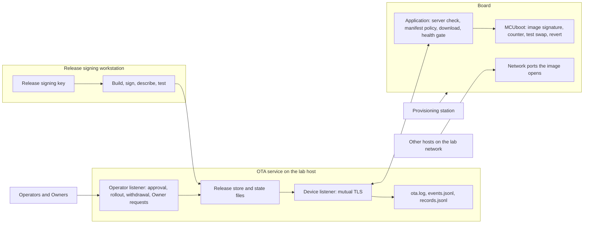

# Tier 10: Defend the integrated reference product

## Scenario

Your beacon now carries every control this course has built. It talks only to the genuine service, installs only releases you signed, refuses to go backwards, survives a failed update, holds its own identity, and runs a release that went through an approval and a canary. Tier 9 finished that work.

Today nobody adds anything. Today you are the operator on duty.

The shift starts quietly. Your board runs the Remediation release at security counter 6, the fleet is offered the same release, and no rollout is open. A teammate has prepared the next release, a candidate at counter 7, with a short handover note. It is built, signed, tested and approved, and the teammate plans to roll it out.

Then things start to happen. Over the next ten minutes or so, eight events reach the product. You see each one the way an operator sees it: a few lines on the board's console, a line in the service log, a record in the service's files. Nobody tells you what each event is.

Some of what follows is an attack, and some of it is ordinary failure: a mistake, a fault, a release that does not work. Telling them apart from the symptoms is the first half of this tier. Operators who treat every failure as an attack waste their time and their team's trust. Operators who treat every attack as a failure let the attacker keep going.

The second half is the work after the events. One release on the fleet failed its test boot, and you must make the fleet safe without any shortcut around the controls you built. Then you must ship a corrected release through a proper canary, and prove with the course's fixtures that every control still holds.

You will stage the eight events one at a time and write down what you believe each one was before you stage the next. You will recover the failed test boot with the release path alone. You will diagnose the teammate's candidate from its symptoms and its handover note, and ship a corrected release at counter 8. Then you will rerun every board fixture the course has as regression evidence.

At the end you will have an incident record with a timeline you can defend, a recovery record, a corrected release record, a final claim matrix for every Security claim in the course, and a residual-risk summary. This tier ends at the last Mentor review gate of the core course.

## Learning result

After this tier, you can:

- Classify an event from its symptoms alone as an attack, an operational failure or undetermined, and say which evidence would change your answer.
- Place each event on a trust boundary of the Reference product and predict the control that should answer it, before you check.
- Build a timeline from three clocks, the host, the service and a console with no clock, and say which clock each fact came from.
- Recover a failed test boot through the release path only: pause, withdraw, check the Fleet baseline, and prove the board kept its last confirmed image.
- Diagnose a release from its failing check, its serial log and its change, and find the second defect that did not fail the boot.
- Ship a corrected release through a canary that names a real device and confirms before the fleet is offered the release.
- Rerun the course's fixtures as regression evidence, keep board results and host results apart, and say what a passing line does not prove.
- State every Security claim's final status, and every residual risk with who closes it.

## Safety boundary

Run everything against your own Reference product, your own update service and your own board, on the isolated lab network. Use only disposable course credentials, keys and images.

The scenario runner calls fixtures and commands the course already has, with the inputs `course.yml` fixes for it, and adds no attack of its own. The runner sends datagrams only to the board address you recorded, and it never sends the `reboot` request.

Several steps cannot be undone, and each is explained again before its command.

- **The scenario runs once.** It ends with a Release withdrawal of the teammate's candidate, and a withdrawal is permanent. After it, `./course scenario start` refuses in this environment, so you cannot stage the events a second time.
- **Installing counter 8 raises the lowest counter your board accepts.** From then on it refuses every earlier release over the air, including Tier 9's remediation and the teammate's candidate. Repeating the tier from Tier 9 needs a serial flash, as earlier tiers describe.
- **A Release approval is written once.** If you build, sign, describe or test your corrected release again after approving it, the service refuses its rollout because a file changed.

Three shortcuts would make the board look healthy faster: flashing it over USB, restarting the service without `--release-approval`, and writing the service's state file by hand. This tier never needs any of them. If you catch yourself reaching for one, write it down in your incident record as a shortcut you considered, and do not run it.

## Starting state

You need:

- A [Tier 9](../tier-09-vulnerability-support/index.md) board: claimed by an Owner of your own, `active`, running `tier-09-remediation` at security counter 6.
- The Fleet baseline set to `tier-09-remediation`, and no rollout open. `tier-09-support-listener` is approved and withdrawn.
- The four synthetic fleet devices, `beacon-fleet-e9-01` to `beacon-fleet-e9-04`, `active`.
- Tier 4's hostile releases, built in Tier 4 with `./course release hostile --tier 04`. One event uses them.
- Your board's address on record. Tier 9 recorded it with `./course device address`.
- The Tier 9 Security evidence pack, and a clean working tree.

The [course landing page](../../index.md) carries the environment setup, the glossary and the list of every tier, if you need to go back to any of them.

The board in these captures is `beacon-t08c-206ef1170d64`, claimed by `harbor-owner`. It was put back on Tier 9's end state by a serial flash for the capture, because it had run this tier before. You arrive from Tier 9 and need no flash. Your device identifier, digests and times will all differ from the captures.

Start the service in Tier 9's mode, from the repository root, and watch the board:

```text
./course service start --https --mutual-tls --release-approval
./course device logs
```

Expected result on the board: it polls over mutual TLS, is offered the Fleet baseline, and refuses it because it already runs it.

```text
ota.assignment release_id=tier-09-remediation version=0.9.1-remediation image=tier-09-remediation.bin
ota.assignment it also claims size=833364 sha256=d32c1e3e20def2cf164b2421d52d64f94a65a859eea2c8882b1c4bce4ddc79ce
ota.assignment this device believes neither; they are the service's claims
ota.assignment about itself. Only release_id is used, to know what to ask about.
ota.refused check=already-confirmed release_id=tier-09-remediation
ota.refused this device confirmed that image and is running it
```

**Check the Fleet baseline after `./course setup`.** Setup writes the Fleet baseline back to `tier-00-baseline`, and you may need setup because the Course environment marker expires. Tier 9's Starting state shows what the board prints then. After setup, restart the service first, with the command above. A service started before setup still holds the old marker, and it refuses the next command with `403` and a marker mismatch. Then put the baseline back with `./course release assign --tier 09 --variant remediation`. Run `./course regression run` with no other option to check it. That is a dry run, and its `Fleet baseline:` line names the baseline.

**Check the board's address after a host reboot.** The lab router may give the board a new address. Read the `wifi.address` line on its console and record it again with `./course device address <the address>`. One event and the regression run send a datagram to the address on record.

Every control from Tier 9 still holds. What has never been tested is all of them at once, against a mix of attacks and failures, with an operator who has to tell them apart.

## Weakness ledger before the work

Inherited from Tier 9. Not your own work yet.

| Identifier | Weakness | Attack vector | Expected result | Planned treatment |
| --- | --- | --- | --- | --- |
| T2-W-09 | The device has no clock and checks no dates on a certificate it is shown | Present an expired certificate to the device | The device accepts it | Accepted for the core course: device time is evidence, not an authorization input |
| T3-W-10 | The bootloader itself is unverified | Nothing checks MCUboot before it runs | The bootloader runs whatever is there | Advanced Tier A |
| T3-W-11 | The Release signing key lives on the same machine as the build and the service. One key signs the image and the manifest, so taking it defeats both | Sign anything with the release key | Both verifiers accept it | Accepted for the core course. Rotation in Advanced Tier A |
| T4-W-12 | Downgrade prevention does not protect the first install | Install onto a device whose primary image carries no counter | The install is accepted | Accepted for the core course |
| T4-W-13 | The security counter is compared, never remembered | Rewrite the primary slot | The device forgets what it was running | Advanced Tier A |
| T5-W-14 | A power cut during the health window forces a revert indefinitely | Power-cycle during the health window | The device reverts each time | Residual availability risk |
| T5-W-15 | The watchdog depends on a driver quirk an upstream fix would change | Upgrade Zephyr | The behavior changes silently | Recorded limit |
| T5-W-26 | A revert is reported once and nothing acknowledges it, so a board that restarts before it reaches the service never reports that revert | Revert with the service stopped, then restart the board before you start the service | The service never receives the revert report | Recorded limit |
| T6-W-16 | The Secure Storage encryption key is a hash of public values, and a destroyed key stays decryptable in flash | Dump the flash and run the published derivation | The private key is recovered | Advanced Tier B |
| T6-W-17 | Stored records carry no freshness, so an older copy is accepted as authentic, and an older record rewinds the Time floor | Write back a superseded record from the same dump | The device accepts it | No tier on this course closes it |
| T6-W-18 | The private key is protected at rest only | Privileged firmware, the application, or a debugger reads it | The key is reachable | Advanced Tier B |
| T6-W-19 | The AES-GCM nonce is drawn once per boot while the record key never changes | Draw the nonce before the RF subsystem is up | The guarantee weakens | Recheck on any Zephyr upgrade |
| T6-W-27 | The Wi-Fi passphrase is compiled into every image this course builds | Read the strings of any image you built | The passphrase is readable | Recorded limit |
| T7-W-20 | Authorization lifetime is enforced by the service. The device judges only its own Operational certificate, against the Time floor | Cut the device off and let its certificate expire after the last release it verified | The device keeps presenting a dead certificate | Accepted for the core course |
| T7-W-21 | The Owner credential is a bearer token. Its holder can revoke and transfer the owner's devices without touching them | Present a copied Owner credential | The service accepts it | Accepted for the core course |
| T7-W-22 | With `--mutual-tls` the service holds a certificate authority signing key, so compromising the service mints devices | Take the service and its key | Certificates the service accepts | Residual risk with an owner |
| T7-W-23 | The claim endpoint is an oracle. Distinguishable refusals reveal whether a device exists and whether it is owned | Approve a claim for a device you do not own | The refusal says the device is owned | Accepted |
| T7-W-24 | The Factory credential reopens the claim path until the board is decommissioned, and its key survives on the board until a verified erase | Press the button on a claimed device | A Claim window opens | Accepted |
| T7-W-25 | Synthetic devices land in the real manufacturing record with no marker field. The naming convention is the only sign | Read the record | Fixture devices look like real ones | Recorded limit |
| T8-W-28 | A pre-Tier-6 image at an equal security counter erases a Tier 6 or Tier 7 board's identities | Install a Tier 5 image on an enrolled Tier 7 board | The identities are gone | Closed for Tier 8 and later boards. Open for Tier 7 boards |
| T8-W-29 | Whoever holds the Release signing key can end every Operational credential by dating a manifest in the future | Sign a manifest dated far ahead | The device refuses its own certificate from then on | Kept separate from `T3-W-11` |
| T8-W-30 | The station trusts the firmware's own MAC report at enrollment | Report another board's MAC | The station records the wrong board | Recorded limit |
| T8-W-31 | A copied Operational key can renew onto a fresh key, and whichever copy renews first keeps the identity | Renew from the copy before the genuine device does | The genuine device is refused until the owner recovers it | Residual risk with an owner |
| T8-W-32 | A transfer names no recipient, so whoever next presses the button with any Owner credential becomes the owner | Claim a transferred board with any Owner credential | The claim succeeds | Accepted. The press is the binding |
| T8-W-33 | A warm reset leaves key material in readable SRAM | Dump the SRAM over the USB cable in download mode | The public halves of the keys are readable | Recorded limit |
| T9-W-36 | Anyone who can reach the operator listener can approve a release, in any name | Post an approval to the operator listener under any approver name | The service records the approval | Accepted for the core course |
| T9-W-37 | Rollout actions name their actor but do not authenticate it. An unauthorized pause or withdrawal stops a fix from reaching the fleet | Pause or withdraw a rollout under any actor name | The service obeys | Accepted for the core course |

Tier 9 closed `T9-W-34`, the support listener, with the remediation your board runs, so it is not in this table. No row here is the subject of this tier, because Tier 10 adds no control. The scenario tests whether the controls behind these rows still hold together, and whether the people around them use them.

## Work the scenario

The scenario is a sequence of eight events. Each `./course scenario next` stages one of them. Between two events you write down what you believe the last one was, and you write it before you know more.

### Look before you act

**Read the boundary diagram first.** Each event's first-pass row asks which trust boundary something crossed and which control you expect to answer. The diagram and the table of boundaries are in [Investigate the boundaries](#investigate-the-boundaries), below. They show every boundary and plot no event. Read them now, and come back here.

**Copy the templates and commit them.** From the repository root:

```text
mkdir -p evidence/learner/tier-10
cp evidence/templates/tier-10/*.md evidence/learner/tier-10/
git add evidence/learner/tier-10
git commit -m "Start the Tier 10 evidence"
```

Commit before every build in this tier. A build records whether the tree was clean, and the service refuses to approve a release built from a tree with uncommitted changes. You will write in `incident-record.md` during the scenario. Leave `residual-risk-summary.md` closed until all eight events are staged and recovery is over, because its rows describe the answers.

**Build the teammate's candidate.** It is built on your machine, because a release built anywhere else could not be signed with your key:

```text
./course build firmware --tier 10 --variant candidate
```

The build says that it applies the teammate's handover patch to a throwaway copy of the application, and never to your tree. Do not read the patch yet. You will read it when the scenario gives you a reason to.

**Start the scenario.** `./course scenario start` checks the Tier 9 end state before it changes anything: the service's flags, the Fleet baseline, no open rollout, the board's address, and the built hostile releases. It finds your board in the manufacturing record, and never takes a device identifier from you unless there is more than one candidate. Then it signs, describes, tests and approves the candidate as the actor `teammate`. Expected result: two lines, `Scenario ready.` with your board's identifier, and the instruction to run `./course scenario next`. On the capture it named `beacon-t08c-206ef1170d64`.

`./course scenario status` shows how many events are staged, out of eight, and when each was staged. It is the only view of the scenario you get before you stage anything.

**There is no dry run of the events.** Every other fixture in this course prints its plan before it acts. This one cannot, because the plan is the answer. The runner records what it did for each event in `.course-state/scenario/staging.log`. That log is the Mentor's record. Do not read it during the tier.

**What `next` prints.** Each `./course scenario next` prints `Event N staged at <UTC time>`, then a `Look at:` list of places an operator would look, then a line telling you to write your classification. The time is the host's clock, and it is the first entry for that event in your timeline. Some events take several minutes to stage, because they wait for the board, and the command says so.

**Three clocks.** Your timeline names the clock every time came from. The `Event N staged at` line is the host clock. `.course-state/ota.log`, `.course-state/ota/events.jsonl` and `.course-state/provisioning/records.jsonl` carry the service clock, in UTC. The board's console prints no time at all, so a console line is placed by its order between the lines around it. The serial captures on this page were taken with a capture tool that added the host's time to each line. The times in the text come from it, and your own console shows none.

**Console quotes on this page are excerpts.** Each one keeps the lines that bear on the point and leaves out the rest, mostly the two connection lines of every poll. Your own console shows everything.

**The runner also restarts your service when it needs to.** A block of `COURSE SERVICE:` lines in `ota.log` is the runner's own restart, with the Tier 9 flags.

**From Event 5 on, the board works on its own schedule.** It polls, downloads and boots without waiting for you. Write each first classification in a few minutes, then stage the next event. Stage Event 8 within about two minutes of Event 7. In the capture, Event 8 was staged about two and a half minutes after Event 7.

**Act on nothing until Event 8 is staged.** In a real shift you would act the moment something looked wrong. Here, the scenario needs the fleet as the events left it, so you watch and record. The recovery section asks you how much sooner you would have acted.

**Record your first classification.** For each event, write its row in the first-pass table of your incident record before you stage the next event. The first classification is exactly one of `attack`, `operational failure` or `undetermined`. `undetermined` is an honest answer, and a guess is worse. Never edit a first-pass row after the next event is staged. A changed mind goes into the final table, later.

Now run:

```text
./course scenario start
./course scenario next
```

### Event 1

On the capture this event was staged at 19:01:59 UTC.

**What the operator sees.** Around the moment it was staged, the board's console printed:

```text
tls.poll data check err=-0x004c
ota.request failed url=/v1/devices/beacon-t08c-206ef1170d64/events err=-113
```

About half a minute later, on its next two connections, it printed this twice:

```text
tls.setup handshake failed err=-0x2700
ota.tls refused the connection to 192.168.68.77:8443 errno=113
ota.tls required name ota.course.example issued by the trust anchor in this image
ota.tls verification flags 0x00000004
ota.tls  the certificate does not carry the name this device requires
ota.tls  compared: the certificate names against ota.course.example
ota.tls no release data was read, and the running image is unchanged
```

The service log showed the same two connections from its side:

```text
[course-ota] 2026/10/12 19:02:27 http: TLS handshake error from 192.168.68.74:63297: remote error: tls: bad certificate
[course-ota] 2026/10/12 19:02:29 http: TLS handshake error from 192.168.68.74:43785: remote error: tls: bad certificate
```

**Where to look.** The board's serial console, with `./course device logs`, and `.course-state/ota.log`.

**Record your first classification.** Write the Event 1 row, then run `./course scenario next`.

### Event 2

On the capture this event was staged at 19:02:45 UTC.

**What the operator sees.** On the board's next poll, the service offered a release the board had never seen:

```text
ota.assignment offers tier-04-hostile-wrong-key instead of the running tier-09-remediation; asking for its signed manifest
ota.manifest fetched 498 manifest bytes and a 71 byte detached signature
release.refused check=manifest-signature
release.refused   compared: the detached signature against SHA-256 of the 498 manifest bytes exactly as they arrived, using the key compiled into this image
release.refused   rejected: the signature does not verify, status=-149; either these bytes are not what was signed, or they were signed by another key
release.refused   consequence: no image bytes were requested, and the running image is unchanged
```

The service stored the board's report in `events.jsonl`. Its `event` field reads `update.refused`, its `detail` reads `tier-04-hostile-wrong-key`, and its `service_received_at` reads `2026-10-12T19:03:29.026408527Z`. The service log shows only a restart at 19:02:45.

**Where to look.** The board's serial console, and `.course-state/ota.log`. The `events.jsonl` line is the service clock's record of the same moment.

**Record your first classification.** Write the Event 2 row, then run `./course scenario next`.

### Event 3

On the capture this event was staged at 19:03:28 UTC.

**What the operator sees.** On the next poll, the service offered a release the board knew:

```text
ota.assignment offers tier-05-crash instead of the running tier-09-remediation; asking for its signed manifest
ota.manifest fetched 472 manifest bytes and a 70 byte detached signature
release.verified signature over 472 manifest bytes, ECDSA P-256 over SHA-256
release.verified nothing has parsed these bytes yet; that is the point
time.floor stays at 2026-10-08T22:36:44Z; release tier-05-crash was created at 2026-09-23T21:05:21Z, which is not later
release.refused check=security-counter
release.refused   compared: the manifest's security_counter 4 against the counter 6 this running image was built with
release.refused   rejected: a release that would take this device backwards, version 0.5.1-crash
release.refused   consequence: no image bytes were requested, and the running image is unchanged
release.refused   note: the bootloader refuses this too, and its refusal is the one that counts
```

The service stored `update.refused` with the `detail` `tier-05-crash` at `2026-10-12T19:04:29.031472993Z`.

**Where to look.** The board's serial console, and `.course-state/ota.log`.

**Record your first classification.** Write the Event 3 row, then run `./course scenario next`.

### Event 4

On the capture this event was staged at 19:04:30 UTC.

**What the operator sees.** The terminal labels this event a `HOST result`: it ran from this host, not from the board. The board's console shows nothing new. The service's event log gained this line:

```text
{"certificate_serial":"70299574839000881222617709247529039218","certificate_subject":"beacon-bypass-e8-07","check":"device-unrevoked","device_id":"beacon-bypass-e8-07","path":"/v1/releases/current","reason":"this device is revoked, and a revoked device is served nothing until it is remanufactured","service_received_at":"2026-10-12T19:04:30.374422002Z","source":"service"}
```

**Where to look.** `.course-state/ota/events.jsonl`.

**Record your first classification.** Write the Event 4 row, and write in the Symptom column that it is a host result. Then run `./course scenario next`.

### Event 5

On the capture this event was staged at 19:04:39 UTC.

**What the operator sees.** The service's record file, `.course-state/provisioning/records.jsonl`, gained two lines within five milliseconds of each other. The first is a `rollout.started` line, with these fields:

```text
"actor":"teammate","canary_device_ids":["beacon-t08c-206ef1170d46"],"kind":"rollout.started","recorded_at":"2026-10-12T19:04:39.288488907Z"
```

The second is a `rollout.advanced` line:

```text
{"actor":"teammate","kind":"rollout.advanced","recorded_at":"2026-10-12T19:04:39.293550917Z","release_id":"tier-10-candidate","station":"course-ota-service"}
```

Thirty seconds later, a third line recorded that the board was served the release:

```text
{"device_id":"beacon-t08c-206ef1170d64","kind":"rollout.served","recorded_at":"2026-10-12T19:05:10.59845018Z","release_id":"tier-10-candidate","stage":"fleet","station":"course-ota-service"}
```

`./course rollout status` shows the same rollout: its release, its stage, who started it, its Canary group and the devices served so far.

**Where to look.** `./course rollout status`, `.course-state/ota/events.jsonl`, and `records.jsonl`. Your board's own identifier is on its console, on the `identity.state provisioned device_id=` line of every boot.

**Record your first classification.** Write the Event 5 row, then stage Event 6 within a few minutes.

### Event 6

On the capture this event was staged at 19:06:48 UTC.

**What the operator sees.** The board started downloading the release it was offered, and stopped part of the way through:

```text
ota.progress 458752 of 834066 bytes are in the slot
ota.request failed url=/v1/firmware/tier-10-candidate.bin err=-77
ota.install interrupted with 500439 bytes in the slot; the record
ota.install survives and the next poll resumes from there
```

On a later poll it fetched and verified the manifest again, and went on:

```text
ota.resume 458752 of 834066 bytes are already in the slot
ota.resume the manifest was fetched and verified again before this record
ota.resume was allowed to matter. The record says where to resume, never what
ota.resume to believe.
ota.resume requesting Range: bytes=458752-
```

It finished, checked the image, and rebooted into it:

```text
release.digest hashed 834066 bytes read back out of the secondary slot
release.accepted sha256=b108fce4e2047f8269b97b9ab7271d8106b9f730fa3a2179c9443c4b5c035327 matches the signed manifest
ota.install 834066 bytes are in the secondary slot and hash to the signed digest
ota.upgrade requested a TEST swap, not a permanent one
```

The service log recorded both transfers:

```text
[course-ota] 2026/10/12 19:05:30 firmware tier-10-candidate.bin: connection lost after 500439 of 834066 bytes from offset 0
[course-ota] 2026/10/12 19:06:43 firmware tier-10-candidate.bin: sent 375314 bytes from offset 458752
```

The service stored `update.failed` with the `detail` `tier-10-candidate` at 19:05:43, and then `update.installed` with the same detail at 19:06:55.

**Where to look.** The board's serial console, and `.course-state/ota.log`.

**Record your first classification.** Write the Event 6 row, then stage Event 7 within a few minutes.

### Event 7

On the capture this event was staged at 19:07:58 UTC.

**What the operator sees.** The board booted the new image. Its banner said, among other lines:

```text
ESP32-C6 Reference product: Tier 10, integrated defense and the mixed campaign
Image label: candidate
Running release: tier-10-candidate
Security counter of the running image: 7
Trial behaviour compiled into this image: healthy
Tier 10 keeps every Tier 9 control and adds no new one on the device: it is the
integration tier, where the whole defense is exercised at once by a mixed
campaign of attacks and manufacturer failures. It carries Tier 9's remediation
behaviour: the support listener is compiled out and the TF-PSA-Crypto backport
for CVE-2026-50583 is carried.
```

After it joined the network, it started its trial:

```text
trial.begin this image is unconfirmed, so it has to earn the slot it is in
trial.begin attempt 1 of 3 for release tier-10-candidate
health.gate running 4 local checks, then a 60 second window
health.gate no check asks whether the service is reachable. Section 6 forbids
health.gate network loss alone from failing this gate.
health.check image-integrity      pass
health.check credentials-loaded   pass
health.check beacon-running       pass
health.check update-client-ready  pass
health.gate every check passed, holding for 60 seconds
support.listener listening on UDP 7700 for inventory and reboot
support.listener it asks no one who they are (T9-W-34)
```

A few seconds later:

```text
health.gate holding, 54 seconds left
health.check beacon-advancing     FAIL with 49 seconds left
health.gate the window did not complete: the beacon stopped
trial.revert the health window expired at check beacon-advancing
trial.revert this image is still unconfirmed, so MCUboot will put the last
trial.revert confirmed image back on the next boot without being asked
```

The board restarted, came back on `tier-09-remediation` at counter 6, and reported. The service stored `update.reverted` at `2026-10-12T19:07:57.340963379Z`, with the `detail` `tier-10-candidate beacon-advancing`.

**Where to look.** The board's serial console, and `.course-state/ota/events.jsonl`. Compare what the boot banner says about this image with what the image does after it.

**Record your first classification.** Write the Event 7 row quickly, then stage Event 8.

### Event 8

On the capture this event was staged at 19:10:24 UTC. Staging it takes a few minutes, and the command says so.

**What the operator sees.** While it was staging, the board was offered the same release again, downloaded it again, and booted it on trial again:

```text
trial.begin attempt 2 of 3 for release tier-10-candidate
health.gate running 4 local checks, then a 60 second window
```

The four local checks passed, and then:

```text
health.gate every check passed, holding for 60 seconds
support.listener listening on UDP 7700 for inventory and reboot
support.listener it asks no one who they are (T9-W-34)
support.inventory answered 192.168.68.77:57060, unauthenticated
health.gate holding, 54 seconds left
health.check beacon-advancing     FAIL with 49 seconds left
health.gate the window did not complete: the beacon stopped
```

**Where to look.** The board's serial console.

**Record your first classification.** Write the Event 8 row. Then go straight to [Recover the failed test boot](#recover-the-failed-test-boot), and come back to [Investigate the boundaries](#investigate-the-boundaries) after it. The board will try the same release again on its next poll.

### When all eight rows are written

Your first pass is now fixed. It records what you believed while you had only the symptoms, and nothing later changes it.

The answers are in [the Tier 10 Mentor key](mentor-key.md): what each event was, the boundary it reached, the control that should answer it, and the shortcuts that tempt an operator. **Do not open it before all eight first-pass rows exist.** The page is public, and the gate tests your reasoning, not your recall. After recovery, write the final table in your incident record from your own evidence first. Then compare it with the key, and record the differences rather than copying the answers.

## Investigate the boundaries

The integrated product has more trust boundaries than any single tier showed. The diagram below has all of them, and it plots no event. Your incident record asks you to place each event on one of them.



The boundaries come from section 2 of the course specification. Each row names who makes the trust decision there, and the controls from earlier tiers that stand on it.

| Boundary | Who decides | What stands on it |
| --- | --- | --- |
| The device and the local Wi-Fi network | The device, by what its image opens and answers | Nothing checks a sender. Tier 9's remediation answered `T9-W-34` by opening no support port at all |
| The device and the OTA service | Both sides. The device checks the service's certificate and name. The service checks the device's certificate, owner and state | `CTL-03`, the device's server check. `CTL-04` and `CTL-11`, mutual TLS and the owner scope. `CTL-12` to `CTL-14`, revocation, renewal and decommissioning. Tier 5's resumable download |
| The release signing workstation and the OTA service | The device, because the service holds no signing key and is not trusted with releases | `CTL-02`, the signed manifest and the security counter in the application. `CTL-01`, MCUboot's signature and counter checks. `CTL-06`, key custody |
| The provisioning station and the device | The station and the manufacturing record | `CTL-08` and `CTL-09` |
| MCUboot and the Zephyr application | MCUboot, which keeps the last confirmed image until the application confirms a new one | `CTL-05`, test boot, confirmation and automatic revert, with the application's health gate |
| The customer operator and the manufacturer service | The service, on the operator listener | `CTL-10`, `CTL-11` and `CTL-16` for owners. `CTL-17` and `CTL-18`, Release approval, rollout and withdrawal, for the manufacturer's own operators |

A seventh boundary, between the ESP32-C6 and a secure element, belongs to Advanced Tier B and is not in this product. An event that crossed no boundary at all has `none` as its boundary.

The board owns the decisions that matter most, because it is the only party that never trusts the service. The service owns the operator listener, and Tier 9 found that the listener knows no one's identity: anyone who reaches it acts in any name, which is `T9-W-36` and `T9-W-37`. The people around the product own the steps no code enforces, and the manufacturer owns the release signing key, which no tier in the core course separates from the service host.

Work through these questions after recovery, with your first-pass table beside you. Answer them in your final table, not in the first pass.

1. Which events did the board refuse by itself, and what did each refusal compare?
2. Which event did nothing refuse at all? Which party could have refused it, and when?
3. Which event's symptom pointed at a boundary that it never crossed?
4. Which event did you see only through a host result, and what would a board result for it have looked like?
5. For each event you first called `undetermined`, which timeline row settled it?

## Recover the failed test boot

The fleet holds a release that failed its test boot, and the board will keep trying it until the release goes away or the board reaches its trial limit. Make the fleet safe before you fix anything. This section changes nothing about the candidate itself. It puts the fleet back on the release it ran before the scenario, through the release path alone.

Save the board's serial log and copies of `events.jsonl` and `records.jsonl` before step 1, and write their paths into your recovery record. Every step below changes what those files show.

### Step 1: Pause the rollout

```text
./course rollout pause --actor <your name>
```

A paused rollout offers its release to no new device. `--actor` is required, and nothing checks it, which is `T9-W-37`. On the capture the service recorded `rollout.paused` with the actor `tarjei` at `2026-10-12T19:10:28.894790783Z`, four seconds after Event 8 was staged.

### Step 2: Withdraw the candidate

A withdrawal is permanent, and it names the vulnerability record it answers. Add a record for the candidate to your vulnerability records from Tier 9, `evidence/learner/tier-09/vulnerability-records.md`, with the next free number, and use its identifier. The capture used `VR-10-01`:

```text
./course release withdraw --tier 10 --variant candidate --reason VR-10-01 --actor <your name>
```

Expected result: the command reports that `tier-10-candidate` is withdrawn and will never be served again, and that its open rollout is closed. On the capture, `records.jsonl` gained this line 72 milliseconds after the pause:

```text
{"actor":"tarjei","kind":"release.withdrawn","reason":"VR-10-01","recorded_at":"2026-10-12T19:10:28.966617624Z","release_id":"tier-10-candidate","rollout_closed":true,"station":"course-ota-service"}
```

### Step 3: Confirm the Fleet baseline

With no rollout open, every device is offered the Fleet baseline. It must still be `tier-09-remediation`. Check it from the service and from the board.

From the service, run `./course regression run` with no other option. That is the dry run, and it changes nothing. Expected result: `Fleet baseline: tier-09-remediation` and `Open rollout: none`. Run `./course fleet poll` too. Expected result: all four synthetic devices are offered `tier-09-remediation`, marked `HOST`.

From the board, on its next poll after it returns to counter 6:

```text
ota.assignment release_id=tier-09-remediation version=0.9.1-remediation image=tier-09-remediation.bin
ota.refused check=already-confirmed release_id=tier-09-remediation
ota.refused this device confirmed that image and is running it
```

### Step 4: Show the board is confirmed at counter 6

Use two sources, the board's console and the service's record. One source alone is not enough, because each can be wrong about the other.

The board's console, after the second trial gave up:

```text
I: course: slot=primary header=ok tlv=ok signature=present key=match counter=6
Running release: tier-09-remediation
Security counter of the running image: 6
boot.state running image is confirmed
boot.state the previous boot gave up on release tier-10-candidate at check beacon-advancing
boot.state and MCUboot has put this image back. That is a revert.
event.queued update.reverted release_id=tier-09-remediation detail=tier-10-candidate beacon-advancing
recovery.state trial release_id=tier-10-candidate attempts=2 of 3 reported=yes
support.listener absent: removed in the remediation release (T9-W-34)
support.listener nothing on this image listens for inventory or reboot
```

The service's record: `update.reverted` with the `detail` `tier-10-candidate beacon-advancing` at `2026-10-12T19:10:57.78751951Z`, and then `update.refused` with the `detail` `already-confirmed` and `running_release_id` `tier-09-remediation` at `2026-10-12T19:11:14.908012463Z`.

### Count the trial attempts

The `recovery.state` line says the board tried the candidate twice before the withdrawal, `attempts=2 of 3`. The two `update.reverted` lines in `events.jsonl` say the same. Copy the number into your recovery record and into your incident timeline as a fact.

Each attempt was a trial boot of about one minute, and in each one the support port was open for about ten seconds. That is why recovery was urgent and why waiting for the trial limit was never safe. The board would have refused the candidate after its third failure. Until then, every retry was another window, and the release stayed on offer to every device.

### What this recovery proves

The board kept its last confirmed image. MCUboot put it back by itself after each failed trial, and nobody flashed anything over USB. The service still runs with `--release-approval`, and you prove that with `E-10-05` before you approve your own release. Every step was a command on the release path, recorded in `records.jsonl` with a time and an actor.

Recovery did not fix anything. The candidate is still wrong, and only a corrected release at a higher counter moves the fleet forward.

Now go back to [Investigate the boundaries](#investigate-the-boundaries) and answer its questions in your final table.

## Correct and ship the release

### Diagnose the candidate

Work from the failing check to the change that caused it. Read three things, in this order, and do not search the source tree:

1. The stored revert: `update.reverted` with the `detail` `tier-10-candidate beacon-advancing`. It names the check that failed.
2. The serial log of the same trial boot, from Event 7. Note when each health line appeared, and what else started during the window.
3. The teammate's handover, [`teammate-candidate.patch`](../../../firmware/tier-10-integrated-defense/handover/teammate-candidate.patch). It is a short note and a two-hunk patch.

For each hunk, decide what it did to the trial you watched. Then decide which hunk caused the failed boot, and which one did not fail anything.

One timing fact helps. The health gate samples every 5 seconds, and `beacon-advancing` failed at the second sample, `with 49 seconds left`. So the window lasted about ten seconds, not sixty. Whatever started at the beginning of that window was reachable for about ten seconds of each trial.

Look at the banner again too. It says the support listener is compiled out. A few lines later the same image prints `support.listener listening on UDP 7700`. When a summary and a behavior disagree, believe the behavior. A summary line is text somebody wrote once, and nothing checks it against the image.

Record both defects in the diagnosis table of your incident record, and fill in the three fields under it.

### Fix both defects

In this course your corrected source is the committed tree under `firmware/tier-10-integrated-defense`. The candidate is that tree with the handover patch applied to a copy, so correcting the release means rejecting the patch's changes. For each defect, write in your corrected release record the file and line in your tree that holds the corrected state, and how you checked it.

Check both. A fix for the defect that failed the boot does not remove the other one. A release with only the beacon fixed would pass its health gate, confirm on the canary, and still answer anyone on UDP 7700 during every trial and after it.

### Build, sign, describe and test counter 8

Commit your evidence first, so the tree is clean. Then:

```text
./course build firmware --tier 10 --variant corrected
./course release sign --tier 10 --variant corrected
./course sbom firmware --tier 10 --variant corrected
./course release test --tier 10 --variant corrected
```

Expected result: `Result: tier-10-corrected passed every pre-release check`. The test's last lines say that its checks never boot the image or run the fixtures, so a release that regresses a control still passes, which is `T10-W-39`. That is exactly how the candidate got its approval.

### Prove the approval check is still on

Before you approve the release, try to make it the Fleet baseline directly:

```text
./course release assign --tier 10 --variant corrected
```

Expected result: `409` at check `release-approved`, because the release has no approval record. This is `E-10-05`. It proves the service still runs with `--release-approval` after the scenario's restarts.

### Approve it

```text
./course release approve --tier 10 --variant corrected --approver <your name>
```

Expected result: six digest lines and `Result: tier-10-corrected is approved by <your name>`. Copy the six digests into your corrected release record beside the ones you compute yourself.

### Roll it out to a canary that exists

Read your board's identifier from its own console, the `identity.state provisioned device_id=` line, and copy it. Do not type it from memory. Then start the rollout with your board as the only member of the Canary group:

```text
./course rollout start --tier 10 --variant corrected --canary <your device id> --actor <your name>
```

On the capture the service recorded `rollout.started` at `2026-10-12T19:11:37.931635299Z`, with `canary_device_ids` `["beacon-t08c-206ef1170d64"]`. It recorded `rollout.served` for the board at the stage `canary` at `2026-10-12T19:11:56.253090258Z`.

The board took the release on that poll, verified it, and booted it on trial:

```text
release.admitted release_id=tier-10-corrected version=0.10.1-corrected counter=8 channel=stable
release.accepted sha256=b91d43b34724e59ba7852b7cdec8312142727cf2a4740a558bf1aa777f45ff70 matches the signed manifest
I: course: slot=primary header=ok tlv=ok signature=present key=match counter=8
Running release: tier-10-corrected
Security counter of the running image: 8
trial.begin attempt 1 of 3 for release tier-10-corrected
health.gate every check passed, holding for 60 seconds
health.gate holding, 54 seconds left
health.gate holding, 49 seconds left
```

The window ran its full sixty seconds this time:

```text
health.gate holding, 4 seconds left
health.gate holding, 0 seconds left
health.gate passed
trial.confirm this image is now the one the device falls back to
event.queued update.confirmed release_id=tier-10-corrected detail=health gate passed
```

After it joined the network:

```text
support.listener absent: removed in the integrated-defense release (T9-W-34)
support.listener nothing on this image listens for inventory or reboot
```

The service stored `update.confirmed` with the `detail` `health gate passed` and `running_release_id` `tier-10-corrected` at `2026-10-12T19:14:03.753634686Z`. That is the canary's answer, and you need it before anything else happens.

### Run the support-listener regression before you advance

A confirmed canary shows the release is healthy. It does not show that the release kept every control, and the candidate is the proof. So, before the advance, rerun the one fixture that can reach the board while a rollout is open:

```text
./course regression run --execute regression --only tier-09/support-listener
```

The capture's answer, at 19:14:09:

```text
Regression rerun, Tier 10
Target: http://127.0.0.1:8080
Interface: loopback
Marker fingerprint: sha256:cbf1f577a65c7f81f6bab7a2e065d061311121ef04c6d1ca7ab2aa7b6bd1ded2
Course revision: 5820fb2b6dffd2c194c9f9c36eb7208fe5389181
Board: beacon-t08c-206ef1170d64, last status 2026-10-12T19:14:09Z, running tier-10-corrected
Against: tier-10-corrected, counter 8, image sha256 b91d43b34724e59ba7852b7cdec8312142727cf2a4740a558bf1aa777f45ff70
  signed manifest sha256 ef80cb36e4be993fee44420307fa626da7563e49986d3fef9c2f6e9a8d1dd599, signature verified
  built from d9300420b14e6578ef81fc5f0265e2592d49aa16, clean tree true
Fleet baseline: tier-09-remediation
Open rollout: tier-10-corrected, stage canary, paused false

Board results
board  tier-09/support-listener --request inventory      pass       expected absent, observed absent; the board's stack answered port unreachable on UDP 7700 (attempt 1 of 4)

Host results. A host result never stands in for a board result.

Board: 1 pass, 0 fail, 0 no result, 0 not run
Host: 0 pass, 0 fail, 0 no result, 0 not run
Receipt: .course-state/regression/20261012T191409.931192403Z.json
Result: pass
```

Why only this one fixture? Every other board fixture publishes its release through the Fleet baseline, and a device in an open rollout is offered the rollout's release instead. While your rollout is open, those entries cannot reach the board, and the full run would report each as `no result`. So the order is fixed: the support-listener entry before the advance, and the full rerun after the rollout is complete. That order is the manual step `T10-W-39` rests on, and nothing in the service enforces it.

### Advance, then complete

The `update.confirmed` time must be earlier than the advance. Check it, then offer the release to the rest of the fleet:

```text
./course rollout advance --actor <your name>
./course fleet poll
./course rollout complete --actor <your name>
```

On the capture the service recorded `rollout.advanced` at `2026-10-12T19:14:15.480866973Z`, twelve seconds after `update.confirmed`. It recorded `rollout.served` at the stage `fleet` for `beacon-fleet-e9-01` to `beacon-fleet-e9-04` within the next 90 milliseconds, and `rollout.completed` at `2026-10-12T19:14:15.703848642Z`. `complete` writes the release as the new Fleet baseline and closes the rollout. The board's next poll:

```text
ota.assignment release_id=tier-10-corrected version=0.10.1-corrected image=tier-10-corrected.bin
ota.refused check=already-confirmed release_id=tier-10-corrected
ota.refused this device confirmed that image and is running it
```

Fill in the canary and completion sections of your corrected release record now.

## Rerun the regression fixtures

The corrected release is the Fleet baseline and no rollout is open, so every board fixture can reach the board again. Look at the plan first, then run it:

```text
./course regression run
./course regression run --execute regression
```

The dry run prints the plan: every board entry, every host entry, and every fixture left out with its reason. The run then takes about ten minutes, because each board entry waits for the board's next poll. Each board entry publishes one release through the Fleet baseline, waits for the board's own report in `events.jsonl`, and puts the baseline back before the next.

The capture's final run started at 19:35:39, after a fix to the Tier 7 host rows, and ended at 19:45:48. Its header and board results:

```text
Regression rerun, Tier 10
Target: http://127.0.0.1:8080
Interface: loopback
Marker fingerprint: sha256:cbf1f577a65c7f81f6bab7a2e065d061311121ef04c6d1ca7ab2aa7b6bd1ded2
Course revision: cfe308a6128e529ae28052634c70ef6e984d48d1
Board: beacon-t08c-206ef1170d64, last status 2026-10-12T19:34:58Z, running tier-10-corrected
Against: tier-10-corrected, counter 8, image sha256 b91d43b34724e59ba7852b7cdec8312142727cf2a4740a558bf1aa777f45ff70
  signed manifest sha256 ef80cb36e4be993fee44420307fa626da7563e49986d3fef9c2f6e9a8d1dd599, signature verified
  built from d9300420b14e6578ef81fc5f0265e2592d49aa16, clean tree true
Fleet baseline: tier-10-corrected
Open rollout: none

Board results
board  tier-09/support-listener --request inventory      pass       expected absent, observed absent; the board's stack answered port unreachable on UDP 7700 (attempt 1 of 4)
board  tier-04/hostile-release --release modified        pass       expected refused, observed refused; offered tier-04-hostile-modified
board  tier-04/hostile-release --release wrong-key       pass       expected refused, observed refused; offered tier-04-hostile-wrong-key
board  tier-04/hostile-release --release hardware        pass       expected refused, observed refused; offered tier-04-hostile-hardware
board  tier-04/hostile-release --release channel         pass       expected refused, observed refused; offered tier-04-hostile-channel
board  tier-04/hostile-release --release size            pass       expected refused, observed refused; offered tier-04-hostile-size
board  tier-04/hostile-release --release digest          pass       expected refused, observed refused; offered tier-04-hostile-digest
board  tier-04/hostile-release --release counter-mismatch  pass       expected refused, observed refused; offered tier-04-hostile-counter-mismatch
board  tier-04/replay-release                            pass       expected refused, observed refused; offered tier-09-remediation
board  tier-03/hostile-image --image unsigned            pass       expected refused, observed refused; offered tier-03-hostile-unsigned
board  tier-03/hostile-image --image wrong-key           pass       expected refused, observed refused; offered tier-03-hostile-wrong-key
board  tier-00/altered-image                             pass       expected refused, observed refused; offered tier-00-altered
```

The host results come next, under their own heading, and the board counts never include them. These are the host lines that passed on the capture:

```text
Host results. A host result never stands in for a board result.
host   tier-00/plaintext-inspection                      pass       expected not-served, observed not-served; GET /v1/releases/current on the plain port answered 404
host   tier-02/plaintext-inspection                      pass       expected refused, observed refused; a verified client with no client certificate was refused: Get "https://ota.course.example:8443/v1/releases/current": remote error: tls: certificate required
host   tier-02/service-impersonation                     pass       expected refused, observed refused; the imposter's certificate was refused: Get "https://ota.course.example:18443/v1/releases/current": tls: failed to verify certificate: x509: certificate signed by unknown authority
host   tier-02/name-mismatch                             pass       expected refused, observed refused; the imposter's certificate was refused: Get "https://ota.course.example:18443/v1/releases/current": tls: failed to verify certificate: x509: certificate is valid for ota-not-this-one.course.example, not ota.course.example
host   e-6-07                                            pass       expected refused, observed refused; E-6-07 refused at credential-carried, as the tier requires
host   e-7-10                                            pass       expected refused, observed refused; E-7-10 refused at ownership-context, as the tier requires
host   e-7-15                                            pass       expected refused, observed refused; E-7-15 closed the handshake and left nothing behind, as the tier requires
host   e-8-01                                            pass       expected refused, observed refused; E-8-01 refused at claim-window-open, as the tier requires
host   e-8-02                                            pass       expected refused, observed refused; E-8-02 refused at identifier-consistent, as the tier requires
host   e-8-03                                            pass       expected refused, observed refused; E-8-03 refused at key-unused, as the tier requires
host   e-8-04                                            pass       expected refused, observed refused; E-8-04 refused at renewal-due, as the tier requires
host   e-8-05                                            pass       expected refused, observed refused; E-8-05 refused at certificate-active, as the tier requires
host   e-8-06                                            pass       expected refused, observed refused; E-8-06 refused at certificate-active, as the tier requires
host   e-8-07                                            pass       expected refused, observed refused; E-8-07 refused at device-unrevoked, as the tier requires
host   e-8-08                                            pass       expected refused, observed refused; E-8-08 refused at certificate-active, as the tier requires
host   e-8-09                                            pass       expected refused, observed refused; E-8-09 refused at device-in-service, as the tier requires
host   e-8-10                                            pass       expected refused, observed refused; E-8-10 refused at hardware-in-service, as the tier requires
```

The capture's other eleven host lines, `e-7-03` to `e-7-09` and `e-7-11` to `e-7-14`, reported `no result`. That came from the capture bench's own history: an earlier reset, before Tier 7 was published, removed the private keys those rows had enrolled. Your environment does not have that history. If one of your host lines reports it anyway, [Troubleshooting](#troubleshooting) says what to record.

In your environment every host line should pass. The run then ends with its counts, the receipt path and the verdict. With every line passing, the four last lines read `Board: 12 pass, 0 fail, 0 no result, 3 not run`, then `Host: 28 pass, 0 fail, 0 no result, 4 not run`, then `Receipt:` with the path of your receipt under `.course-state/regression/`, and last `Result: pass`. That is a description of what the command prints, not a capture. Any line that is not a pass makes the result `fail`, and the command says that every such line is listed above it.

The plan leaves seven fixtures out, and prints each as `not run` with its reason. One is the support listener's `reboot` request, which would burn a trial attempt or restart a healthy board. Two are Tier 3 hostile images refused at the same point as the two that run. The other four are host fixtures that test nothing about the running release, or repeat what another entry covers.

### The planted regression, before and after

The capture also ran the support-listener entry once against the candidate, during its first trial at 19:07:21, while the teammate's rollout was still open. You cannot repeat it, because the candidate is withdrawn, but it is the line the corrected release must change from `fail` to `pass`:

```text
Board: beacon-t08c-206ef1170d64, last status 2026-10-12T19:06:19Z, running tier-09-remediation
On trial: tier-10-candidate, installed 2026-10-12T19:06:55Z. The board is executing it now.
Against: tier-10-candidate, counter 7, image sha256 b108fce4e2047f8269b97b9ab7271d8106b9f730fa3a2179c9443c4b5c035327
  signed manifest sha256 8dfa83c0b96222d66c5fcc512f4d08d233816551c3cfb4c8f44bba83ba25e8b0, signature verified
  built from d9300420b14e6578ef81fc5f0265e2592d49aa16, clean tree true
Fleet baseline: tier-09-remediation
Open rollout: tier-10-candidate, stage fleet, paused false

Board results
board  tier-09/support-listener --request inventory      fail       expected absent, observed answered; unauthenticated inventory answered "device_id=beacon-t08c-206ef1170d64 release_id=tier-10-candidate security_counter=7" (attempt 1 of 4, T10-W-38)
```

Against counter 8, the same request got `port unreachable on UDP 7700`. Read that refusal for what it is. No security check refused the datagram. The board's network stack said that no socket is open on that port. That is weak evidence on its own, because Tier 9 showed the board sometimes answers nothing at all. The strong evidence is the boot log of the image itself, `support.listener absent: removed in the integrated-defense release (T9-W-34)`, and the source you checked when you fixed it. The regression line is the independent check beside them.

### What a pass does not prove

Every board line above passed, and every one of them is the board's own stored record, read from `events.jsonl`. Two groups of them prove less than their names suggest.

**Four Tier 4 checks did not run.** The `channel`, `size`, `digest` and `counter-mismatch` manifests were derived from the newest Tier 4 release, at counter 2. The board checks the signature, the hardware and then the counter, before it checks the channel. So on a board at counter 8, all four were refused at the counter:

```text
release.refused check=security-counter
release.refused   compared: the manifest's security_counter 2 against the counter 8 this running image was built with
```

The run shows that the release policy refuses all seven hostile manifests. It does not show the channel, size and digest checks firing on Tier 10. Write that as a gap in your final claim matrix.

**Three releases never reached a signature check.** The two Tier 3 hostile images and the Tier 0 altered image have no signed manifest. The board asks for one, the service answers `404`, and the board refuses before it requests a single image byte, so MCUboot's own check is never reached:

```text
refused check=none status=404 path=/v1/releases/tier-03-hostile-unsigned/manifest
```

That is where a stored refusal reading `check=none`, such as `tier-03-hostile-unsigned check=none`, comes from: a release with no signed manifest at all.

Every stored refusal from the corrected release names its check this way, after the release identifier. Tier 9's records named only the release, which is why Event 2's line had no `check=`. [What this tier found in the tiers before it](#what-this-tier-found-in-the-tiers-before-it) explains why that matters.

### What an attacker still controls

Whoever can write the service's state directory can still offer any release without asking the service, past approval and past the rollout. The board is still what refuses it, and the regression's release entries publish exactly that way.

Whoever can reach the operator listener can still approve a release, start a rollout with a Canary group of devices that do not exist, and advance it at once. Nothing in the service checks that a canary confirmed, which is `T10-W-40`.

Whoever ships a release that regresses a control still gets it approved, because the approval checks files, not behavior, which is `T10-W-39`.

Whoever holds the Release signing key can still do everything `T3-W-11` says.

What they no longer achieve: the corrected release opens no support port at any point in its life, including its trial. The candidate is withdrawn, and the board at counter 8 refuses it, and every release below 8, over the air.

## Test safety and failure behavior

Ten rows. The `Observed on` column says who produced each result. `device` means your board produced it. `host` means the service or a course command produced it on this machine. A host result never stands in for a device result.

| Evidence ID | Test | Expected result | Observed on | Actual result |
| --- | --- | --- | --- | --- |
| E-10-01 | The candidate fails its trial on the board | The board reverts to `tier-09-remediation` at counter 6 by itself, and the service stores `update.reverted` naming `beacon-advancing` | device | |
| E-10-02 | Recovery with no USB flash: pause, then withdraw | The board is offered `tier-09-remediation` and refuses it as `already-confirmed`, and its boot log shows counter 6 confirmed | device | |
| E-10-03 | Start a rollout of the withdrawn candidate | Refused at `release-withdrawn` | host | |
| E-10-04 | Set the withdrawn candidate as the Fleet baseline with `./course release assign --tier 10 --variant candidate` | Refused at `release-withdrawn` | host | |
| E-10-05 | Set the corrected release as the Fleet baseline before it is approved | Refused at `release-approved` | host | |
| E-10-06 | The corrected rollout names the board's real identifier as the canary | `rollout.served` at the stage `canary` for the board, and `update.confirmed` earlier than `rollout.advanced` | device | |
| E-10-07 | The support-listener regression against counter 8 while the rollout is open | `pass`: port unreachable on UDP 7700 | device | |
| E-10-08 | The full regression run while a rollout is open | Every release entry is `no result: not offered`, never `pass` | host | |
| E-10-09 | Tier 9's remediation offered to the board at counter 8, by the replay entry | Refused at `security-counter`, 6 against 8, with no image bytes requested | device | |
| E-10-10 | `./course scenario start` after the candidate is withdrawn | Refused: the withdrawal is permanent, and the scenario cannot be staged again | host | |

The capture produced `E-10-01`, `E-10-02`, `E-10-06`, `E-10-07` and `E-10-09`, and this page quotes them in the sections above. It did not run `E-10-03`, `E-10-04`, `E-10-05`, `E-10-08` or `E-10-10`, so your actual result is the first one recorded for each. Run `E-10-08` only if you want to, and only before you advance: it takes as long as a full run and changes nothing.

Three rows deserve a second look.

**`E-10-02` is the recovery proof.** The board got back to a confirmed image without anyone touching it. MCUboot kept the last confirmed image through two failed trials, and the release path did the rest. A recovery that needed a USB cable would have worked too, but it would have proved only that you can reflash a board on your desk. Devices in the field cannot be recovered that way.

**`E-10-06` is the canary the teammate skipped.** A canary is only a canary when it names a device that exists and you wait for its confirmation. The service checks neither, so the row is a record of your own discipline, not of a control.

**`E-10-08` is the reason the order of the regression runs matters.** A run that reported silence as a pass would let a rollout hide every refusal. The command reports `no result` instead, and tells you why.

Record any unexpected actual result before you troubleshoot it, and do not mark a Security claim supported because of a result you have not seen.

## Weakness ledger after the work

This is the result you should expect to observe. Your own ledger lives in your workspace under `evidence/learner/`.

Only rows the scenario surfaced are listed. Every row inherited from Tier 9 is unchanged by this tier, and each one appears with its owner and group in your residual-risk summary. The scenario's other events were refused by the controls behind those rows, and refused the way earlier tiers showed.

| Weakness | Result after this tier | Status | Evidence or next action |
| --- | --- | --- | --- |
| T10-W-38 | New. The candidate starts the support listener before the health gate, so every trial boot answers unauthenticated `inventory` and `reboot` on UDP 7700. A regression of `T9-W-34` | Closed | Fixed by `tier-10-corrected`. The support-listener regression against counter 8 answers port unreachable, which is `E-10-07`, and the boot log says the listener is absent. The candidate is withdrawn, and counter 8 refuses it |
| T10-W-39 | New. Release test and approval never boot the image or run the fixtures, so a release that regresses a control passes approval | Accepted | Accepted for the core course. The manual step is to run the support-listener regression before the advance, and the full rerun after `rollout complete`. The service does not enforce either |
| T10-W-40 | New. `rollout advance` does not check that the canary group names real devices or that any of them confirmed, so a rollout can skip its canary | Accepted | Accepted for the core course. The operator names the canary from the board's own console and checks `update.confirmed` before the advance, which is `E-10-06` |

`T10-W-38` is a new row, not a reopened `T9-W-34`. An identifier is never reused, as [the identifier allocation decision](../../../docs/adr/0001-identifier-allocation.md) records, and Tier 9's closed row stays closed. The next new weakness after this tier is numbered 41.

`T10-W-39` and `T10-W-40` look like bugs nobody fixed, and they are left open on purpose. Tier 10 adds no control, because its job is to test the controls that exist. Fixing them means a service that boots a release and runs the fixtures before it records an approval, and a rollout that refuses to advance until a named, real device has confirmed. Both are controls with their own tier's worth of design, and each would bring new weaknesses with it. Accepting them with a manual step and an owner is the honest state of this product. Pretending a checklist is a control would not be.

## Security claim and evidence status

No claim moves in this tier, and that is the expected result. A claim moves only on regression evidence, and the regression shows the controls behind each claim still doing what earlier tiers showed. It shows nothing they did not already show. The scenario adds two open rows, `T10-W-39` and `T10-W-40`, to `SC-09`.

**Three claims you must not make.**

You must not claim that the regression shows every Tier 4 check working on Tier 10. Four hostile manifests were refused at the counter before their own check ran. The run shows the policy refuses them, and no more.

You must not claim that an approved release is a safe release. The candidate was approved with an honest, passing test report, and it failed its boot and reopened a closed weakness. Approval binds the files, not what the files do.

You must not claim that finishing this course shows the Reference product, or you, meets any external standard. Core-course completion is an in-house learning milestone.

The final status of every claim belongs in your [final claim matrix](../../../evidence/templates/tier-10/final-claim-matrix.md), with its evidence from the regression receipt, each line labeled `board` or `host`. The rule the matrix applies is this. A claim is `supported` only with at least one `board` result. A claim whose only evidence is `host` is at most `partly_supported`, and its gap says "host result only".

The expected statuses after Tier 10 are the statuses after Tier 9. `SC-03` stays `supported`. Event 1 is a board refusal of a service with the wrong name, and Tier 2's records are board evidence too. The regression's own Tier 2 lines are host results and add nothing to that. `SC-01`, `SC-02` and `SC-05` stay `partly_supported`, with board evidence from the regression and from Events 2, 3, 6 and 7, and with the gaps earlier tiers named. `SC-04`, `SC-06`, `SC-07` and `SC-08` stay `partly_supported`, and their regression evidence is host only. `SC-09` stays `partly_supported`, with `T10-W-39` and `T10-W-40` added to its open rows.

A regression line that failed is failed evidence for every claim it touches, and a `no result` line is no evidence at all. Name either one in that claim's gap in your matrix, with the reason the line printed.

No control in this course has reached `verified`, and this tier does not change that.

## What this tier found in the tiers before it

Tier 10 is not a control tier, so it does not add to the count [Tier 3 explains](../tier-03-signed-images/index.md#what-this-tier-found-in-tier-2), which stands at seven control tiers out of seven. It found one thing worth your attention anyway, and two more that already have a home elsewhere.

**A record that names the outcome but not the reason cannot tell two controls apart.** Up to Tier 9, the board stored a refusal as `update.refused` with only the release identifier, as Event 2's line shows. A refusal at the signature and a refusal at the counter looked identical in the service's log. Only the serial console said which check ran, and the console is the one record with no clock that nothing on the service side keeps. Nothing failed, because no tier before this one needed a stored record to say which check refused. The regression run must, so the Tier 10 firmware stores the check after the release identifier. Tier 9's records stand as they were written, and the limit belongs to Tier 9's firmware.

Two more findings are recorded where they belong, and are not told again here. The four Tier 4 checks that never ran on Tier 10 are in [What a pass does not prove](#what-a-pass-does-not-prove). The two gaps in Tier 9's release process are `T10-W-39` and `T10-W-40`, in [the ledger](#weakness-ledger-after-the-work).

The two defects in the teammate's candidate are not findings. They were planted for the scenario, and they belong to it.

## Update the Security evidence pack

You created the Tier 10 evidence directory and copied the templates before the scenario. If you have not, do it now, from the repository root:

```text
mkdir -p evidence/learner/tier-10
cp evidence/templates/tier-10/*.md evidence/learner/tier-10/
```

The lab artifact for this tier has five records. Each has its template:

- **The incident record.** [`incident-record.md`](../../../evidence/templates/tier-10/incident-record.md): the timeline with a clock source on every row, the first-pass table you wrote while staging, the final table, the diagnosis of the candidate's two defects, and the response and lessons. This is the incident timeline and the diagnostic evidence.
- **The recovery record.** [`recovery-record.md`](../../../evidence/templates/tier-10/recovery-record.md): pause, withdrawal, the Fleet baseline check, the counter 6 check from two sources, and the number of trial attempts. This is the recovery proof.
- **The corrected release record.** [`corrected-release.md`](../../../evidence/templates/tier-10/corrected-release.md): both defects and their fixes, the six digests and the approval, the canary, and completion. This is the corrected release record and the canary result.
- **The final claim matrix.** [`final-claim-matrix.md`](../../../evidence/templates/tier-10/final-claim-matrix.md): it opens with the regression receipt, then gives every claim, `SC-01` to `SC-09`, its final status.
- **The residual-risk summary.** [`residual-risk-summary.md`](../../../evidence/templates/tier-10/residual-risk-summary.md): every open row, grouped by who closes it. Open it only now, after the scenario and recovery.

Add `T10-W-38`, `T10-W-39` and `T10-W-40` to your Weakness ledger, and name an owner for each of the two accepted rows. Add your vulnerability record for the candidate to your Tier 9 vulnerability records, if you have not already.

Which records become `observed`: every board result you produced, every event you staged, and every refusal the service gave you. Which stay `pending`: any `E-10` row you did not run yourself. Event 4 and every host line of the regression stay `host` results. A host result never stands in for a device result, and it never fills a field the template marks as a device field.

Check the structure of what you wrote with `./course evidence check --tier 10`. Besides the checks every tier gets, it reports a timeline row without one of the three clock sources, a first-pass table that lacks an event or a valid first classification, a claim matrix row without a valid status, or a `supported` claim with no `board` evidence. It also reports a residual-risk row with no group or no owner. It never reads what you wrote.

## Troubleshooting

| Observation | First check |
| --- | --- |
| `scenario start` refuses because the Fleet baseline is `tier-00-baseline` | You ran `./course setup` again. Restart the service with the Tier 9 flags, then `./course release assign --tier 09 --variant remediation` |
| A command fails with `403` and a marker mismatch | The service was started before your last `./course setup`, so it holds the old marker. Restart it with `./course service start --https --mutual-tls --release-approval` |
| `scenario start` refuses because the candidate was withdrawn in an earlier run | The scenario runs once per environment, because a withdrawal is permanent. Bring in a Mentor before you change any service state |
| Event 8 stops without staging, and the board's console shows `check=trial-limit` | The board used all three trial attempts before Event 8 could reach a trial window. Recover as the recovery section says, and record what happened. Bring in a Mentor about the missing event |
| The support-listener regression reports `no result` | Silence is not a pass. Check that the address `./course device address` prints is the one on the board's latest `wifi.address` line, and record it again if it changed |
| `release approve` is refused at `build-tree-clean` | You built from a tree with uncommitted changes, probably your evidence. Commit, then build, sign, describe and test again before you approve |
| The full regression reports `no result: not offered` for every release entry | A rollout is still open. Complete it, then run again |
| A Tier 7 host line reports `no result` and says the fixture `no longer holds its private key` | That environment's Tier 7 fixture keys were removed by an earlier reset. The board results still stand. Record the row as `no result` in your final claim matrix, with that reason in the gap of the claim it touches |

If a refusal names a check you did not expect, stop and read the check before you change anything. In this tier the commands are the ones you already know. A surprise usually means the state is not what you think it is, and that is the moment to bring in a Mentor.

## Informal Mentor conversation

**Tier 10 ends at a required Mentor review gate: the core-course completion gate.** It is the last of the six gates in the core course, and it is the course completion conversation. It is an informal coaching conversation. There is no grade, no score and no pass or fail, and the only outcomes are ready to continue, continue with notes, or resolve a safety prerequisite first. Completing the core course is an in-house learning milestone, and open risks may remain as long as they are visible.

### Show

Run the current Reference product and demonstrate the integrated defense. Your Mentor picks one success and one refusal. Do not rehearse a fixed script, because a demonstration you have rehearsed checks nothing.

- The product working: your board on counter 8, reaching the service over mutual TLS, and the boot log line that says the listener is absent.
- Your incident timeline, read aloud for one event your Mentor chooses, with the clock source of every row.
- Your recovery record: the four steps, the two sources for counter 6, and the trial-attempt count.
- One regression line of your Mentor's choosing, traced from the receipt to the board's own record in `events.jsonl`.
- Your final claim matrix and residual-risk summary.

### Explain

- Your first-pass and final classification for each event, and the timeline row that changed any of them. A changed classification is evidence that you read the evidence, not a mistake.
- Which events the board refused by itself, which one only a host result showed, and which one nothing refused.
- Why Event 6 and Event 7 are not network problems, from the lines you quoted.
- **What an attacker can still do.** Name three things against the product as it stands now: one through the operator listener, one through the service's state directory, and one with the Release signing key. If you cannot name one for each, you have read more into the controls than they do.
- What an attacker could have done with the candidate's listener during a trial, if they had sent `reboot` instead of `inventory`.
- Why you recovered before you corrected, and when a real operator should have stopped the teammate's rollout.

### Diagnose

Your Mentor selects one prepared failure and you work it through together, using the course material, your evidence and any hints you need.

The prepared failure for this gate is **a pass that came from the wrong place**. Your Mentor changes one piece of lab state without telling you which, then asks you to run the support-listener regression against your corrected release. It passes. Every instinct says the listener is gone and the evidence is good. Your Mentor will ask you to prove that the pass came from your board. A good first question is what, exactly, answered the datagram.

The worked answer, the scenario's answer key and the unsafe shortcuts are in [the Tier 10 Mentor key](mentor-key.md). The page is public. Finish your own records first, then compare, and record the differences rather than copying the answers.

### Plan

- Confirm your Weakness ledger: `T10-W-38` closed, `T10-W-39` and `T10-W-40` accepted with an owner, and every inherited row unchanged.
- Confirm that every open row is in your residual-risk summary with a group and an owner.
- Record which results are device results and which are host results, and every row you did not run.
- Write down your open questions, especially any first classification you still cannot settle from the evidence.
- Confirm the end state of the core course: your board on `tier-10-corrected` at counter 8, claimed and `active`; the Fleet baseline set to `tier-10-corrected`, with no rollout open; `tier-10-candidate` approved and withdrawn; and the service running with `--release-approval`.

## Continue

The core course ends here. Your next step is the Mentor review above. It is the core-course completion conversation, and the Mentor records completion when it has taken place.

Two advanced tiers follow for teams with disposable hardware. Both are planned and not yet published. [The course page](../../index.md) lists them and says when each becomes available.

**Advanced Tier A: Add a hardware-rooted boot chain and confidentiality.** Every refusal in this tier was made by MCUboot or by the application, and nothing checks MCUboot itself, which is `T3-W-10`. Advanced Tier A replaces the bootloader with an attack that this product cannot see, then roots the boot chain in the chip with ESP32-C6 Secure Boot v2 and adds flash encryption. Its steps cannot be undone, so it has a Mentor gate before and after the change.

**Advanced Tier B: Isolate operational identity in STSAFE-A120.** The board's private keys are protected at rest only, which is `T6-W-16` and `T6-W-18`. Advanced Tier B extracts a key from the MCU's storage, then moves the Operational identity into a secure element that never exports it. It also shows what a secure element does not stop: compromised firmware can still ask it to sign.

## Primary references

| Reading | Level | Type | Learning question | Where to read |
| --- | --- | --- | --- | --- |
| [NIST SP 800-61 Revision 3, Incident Response Recommendations and Considerations for Cybersecurity Risk Management](https://doi.org/10.6028/NIST.SP.800-61r3) | Required | Guidance | What an incident record tracks, and why detection, classification, containment and recovery are separate steps | The RS.MA, RS.AN and RC.RP outcomes |
| Tier 10 fixtures | Required | Contract | What the scenario runner and the regression run may do, and why a host result never stands in for a board result | `docs/fixture-safety-contract.md`, Tier 10 fixtures |
| Section 13, Mentor review gates and assessment | Required | Specification | What the core-course completion gate asks of you, and what completion means | `docs/course-specification.md` |
| Section 2, Reference product and scenario | Required | Specification | Which actors and trust boundaries an event can belong to | `docs/course-specification.md` |
| [ENISA Reference Security Incident Taxonomy](https://github.com/enisaeu/Reference-Security-Incident-Taxonomy-Task-Force/blob/master/working_copy/humanv1.md) | Optional | Taxonomy | How a taxonomy keeps outages, misconfiguration and undetermined events apart from attacks | The classes outside intrusion and malicious code |
| [Eclipse hawkBit, rollout management](https://hawkbit.eclipse.dev/#/rollout-management) | Optional | Tool documentation | How a fleet platform stops a staged rollout on errors, which this course's rollout does not | The cascading deployment group section |
| Research for the incident record | Optional | Course research | Where each field of the incident record comes from | Issue [#285](https://github.com/tkEmLogic/learning-cyber-security/issues/285) |
